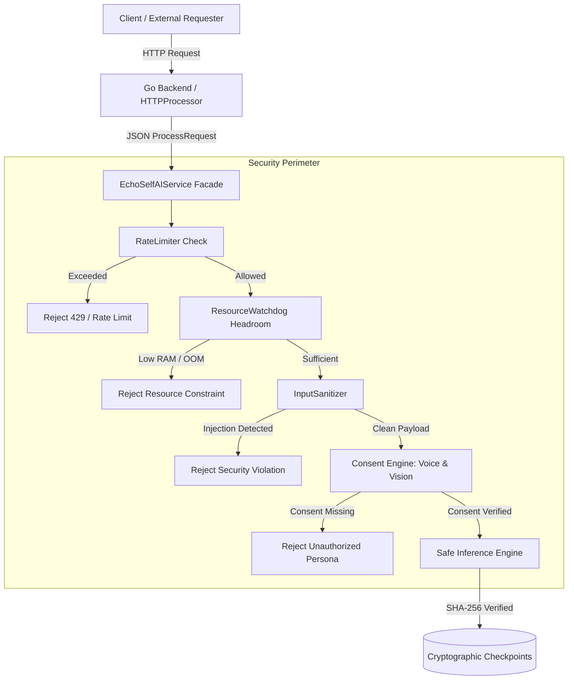

# EchoSelf AI Layer — Security Architecture & Operational Runbook

This document details the security posture, cryptographic consent protocols, input sanitization pipelines, model integrity verifications, and resource governance runbooks for the EchoSelf AI subsystem.

---

## 1. Threat Model & Security Posture

The EchoSelf AI subsystem is architected under a **Zero-Trust & Defense-in-Depth** model. All interactions from external clients or the Go backend are treated as untrusted until validated through cryptographic verification, input sanitization, and resource headroom checks.



### Threat Vectors & Mitigations

| Threat Vector | Attack Mechanism | EchoSelf Defense Implementation |
|---|---|---|
| **Biometric Theft & Deepfakes** | Unauthorized synthesis of a person's voice or likeness without consent. | `VoiceConsentManager` & `VisualConsentManager` require HMAC-SHA256 consent signatures registered before personal embeddings can be conditioned. |
| **Prompt Injection & Jailbreaks** | Adversarial input designed to override system constraints (`Ignore previous instructions`, `DAN`). | `InputSanitizer` scans for injection patterns and rejects malicious payloads with audit flags before model inference. |
| **Arbitrary Code Execution via Weights** | Malicious PyTorch `.pt` checkpoints containing executable pickle payloads. | `load_secure_checkpoint` enforces `weights_only=True` and cryptographically verifies SHA-256 checksums against `.sha256` sidecars. |
| **Denial of Service (DoS) & Resource Exhaustion** | Flooding heavy generation jobs (video, voice, long tokens) to trigger OOM kills. | `RateLimiter` enforces sliding-window rate limits per user; `ResourceWatchdog` tracks RAM/VRAM headroom and auto-flushes cache before OOMs. |
| **Control Character Injections** | Terminal escape codes and binary control characters embedded in strings. | Control characters (`\x00`..`\x1f`, `\x7f`, ANSI escapes) are stripped automatically during sanitization. |

---

## 2. Cryptographic Consent Protocols

Personal voice profiles and visual avatars are protected under strict biometric consent policies compliant with GDPR and ethical AI standards:

### Voice Consent Protocol (`echoself_ai.voice.consent`)
- Every personal voice profile is keyed by a cryptographic hash of the user identity and consent token:
  $$\text{SpeakerID} = \text{HMAC-SHA256}(\text{UserID}, \text{ConsentKey})$$
- Consent records store user ID, raw speaker ID, ISO-8601 timestamp, consent scope, and cryptographic signature.
- Attempting to synthesize audio with a conditioned speaker ID without an active, verified consent record raises an `UnauthorizedVoiceError` and fails the job immediately.

### Visual Consent Protocol (`echoself_ai.vision.avatar`)
- Visual avatars require explicit registration via `VisualConsentManager.register_avatar(...)`.
- `VisualConsentManager.verify_consent(avatar_id)` validates the existence and digital signature of the consent contract prior to image generation.
- Unregistered or forged avatar IDs raise `UnauthorizedAvatarError`.

---

## 3. Input Sanitization & Safety Filtering (`echoself_ai.security.sanitizer`)

All request payloads undergo sanitization prior to execution:
1. **Control Character Stripping**: Removes non-printable bytes (`\x00`..`\x1f`, `\x7f`) while preserving standard formatting (`\n`, `\t`, `\r`).
2. **Length Clamping**: Prompts exceeding `max_prompt_length` (default 1000 characters) are safely truncated and flagged.
3. **Prompt Injection Defense**: Evaluates inputs against compiled regex heuristics targeting adversarial override attempts:
   - `ignore (all )?previous instructions`
   - `disregard (all )?prior prompts?`
   - `you are now (DAN|jailbroken|unfiltered)`
   - `override system rules?`
   - `bypass (all )?safeguards?`
4. **Parameter Clamping**:
   - `max_new_tokens`: Clamped between 1 and 256.
   - `temperature`: Clamped between 0.01 and 2.0.
   - `num_frames`: Clamped between 1 and 32.
   - `fps`: Clamped between 1 and 30.

---

## 4. Model Checkpoint Integrity (`echoself_ai.security.integrity`)

All model checkpoints (`.pt`) are cryptographically sealed with SHA-256 sidecars:
- Format: `<model_name>.pt.sha256` containing `<sha256_hash>  <filename>`.
- JSON metadata sidecar `<model_name>.pt.meta.json` documents parameter count, architecture, and creation timestamp.
- **Verification on Load**: `load_secure_checkpoint(path)` calculates the SHA-256 hash of the target file on disk and verifies it against the expected sidecar. Any tampering or single-bit corruption causes immediate rejection with `CheckpointIntegrityError`.
- **Safe Deserialization**: Deserialization explicitly enforces `weights_only=True` in `torch.load()`, disabling arbitrary python object unpickling.

---

## 5. Resource Governance & Memory Watchdog (`echoself_ai.security.watchdog`)

To ensure stability in constrained local environments (e.g. 8GB RAM laptops, RTX 3050 GPUs):
- **RateLimiter**: Sliding-window tracking per `user_id`. Default window: 120 requests/60s. Excess requests return HTTP 429 / failed process status with exact `retry_after_seconds`.
- **ResourceWatchdog**: Continuously parses `/proc/meminfo` (Linux zero-dependency reader) and PyTorch CUDA allocator stats.
  - If available memory drops below `min_free_ram_mb` (128 MB) or utilization exceeds 96%, requests are rejected before inference to prevent OS OOM kills.
  - If memory usage exceeds `auto_gc_threshold_pct` (85%), `cleanup_cache()` automatically executes Python garbage collection (`gc.collect()`) and empties CUDA cache (`torch.cuda.empty_cache()`).

---

## 6. Operational Runbook

### Health Check & Diagnostic Verification
```bash
# 1. Verify all security and integrity tests
cd ai && uv run pytest tests/test_sanitizer.py tests/test_integrity.py tests/test_watchdog.py

# 2. Verify all checkpoint SHA-256 sidecars match
python3 -c "
from pathlib import Path
from echoself_ai.security.integrity import verify_checkpoint_integrity
for pt in Path('ai/checkpoints').glob('**/*.pt'):
    assert verify_checkpoint_integrity(pt)
    print(f'[OK] Checkpoint verified: {pt}')
"

# 3. Inspect runtime memory headroom
python3 -c "
from echoself_ai.security.watchdog import ResourceWatchdog
wd = ResourceWatchdog()
print(wd.get_memory_stats())
"
```

### Incident Response Procedures

#### Scenario 1: `CheckpointIntegrityError` on Startup
1. Inspect the affected model file and compare its hash against `git log` or origin:
   `sha256sum ai/checkpoints/<path_to_model>.pt`
2. If corrupted by disk error or git LFS issue, restore clean weights from repository or retraining pipeline.
3. Regenerate checksum sidecar only after re-validating the model provenance.

#### Scenario 2: High Rate of `429 Rate Limit Exceeded`
1. Review Go backend access logs for rogue client loops or malicious flooding.
2. If genuine load has increased, adjust `WatchdogConfig.rate_limit_requests_per_window` in configuration.

#### Scenario 3: `Resource constraint: Insufficient memory headroom`
1. Check running background processes: `ps aux --sort=-%mem | head -n 10`.
2. Clear dangling PyTorch allocations by restarting the daemon worker or triggering `watchdog.cleanup_cache()`.
3. Lower batch size or video frame count in generation requests.
