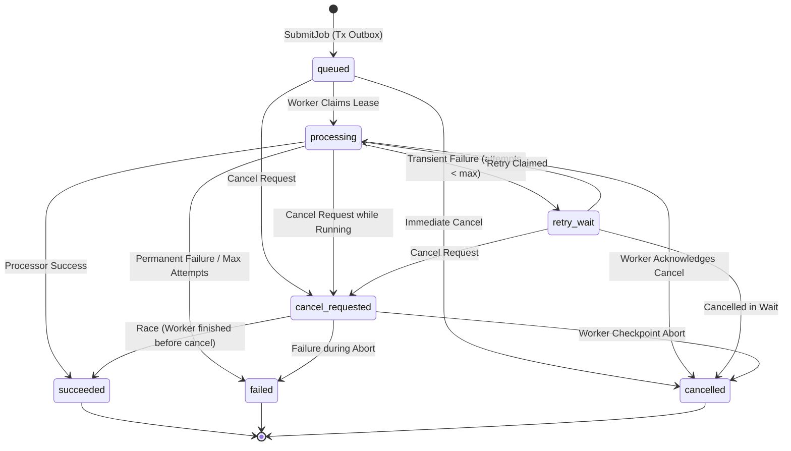

# EchoSelf Background Jobs & Asynchronous Processing

This document details the architecture, configuration, operational lifecycle, and testing of EchoSelf's Redis-backed background job processing system implemented entirely in Go.

---

## 1. Overview & Architecture

EchoSelf implements a durable, asynchronous job pipeline designed to decouple high-latency AI/ML tasks from client HTTP request loops.

```
Client
  │
  ▼ (HTTP POST /api/v1/jobs)
Gin API Server
  │
  ├─────────────────────────────────────────────────┐
  ▼ (Single Atomic Transaction)                     ▼
PostgreSQL `jobs` (status: 'queued')          PostgreSQL `job_outbox` (status: 'pending')
                                                    │
                                                    ▼
                                            Outbox Dispatcher (Go)
                                                    │
                                                    ▼ (LPUSH)
                                            Redis Queue (`echoself:jobs:ready`)
                                                    │
                                                    ▼ (BRPOP)
                                            Go Background Worker (`cmd/worker`)
                                                    │
                                                    ├─► 1. Conditional Claim & Lease (`UPDATE ... status='processing'`)
                                                    ├─► 2. Re-check Cancellation & Purpose Consent
                                                    ├─► 3. Call `processor.Processor` (Mock / Future FastAPI)
                                                    └─► 4. Persist Outcome (`succeeded` / `failed` / `retry_wait`)
```

### Key Guarantees:
* **PostgreSQL as Source of Truth**: Jobs and their execution states are permanently stored in PostgreSQL. Redis acts solely as an ephemeral delivery coordinator.
* **Transactional Outbox**: Job persistence and enqueue events are committed in the same database transaction, eliminating the dual-write failure hazard.
* **Conditional Lease Claims**: Two concurrent workers popping the same job ID cannot execute it concurrently; atomic row-level locks guarantee exactly one lease owner.
* **Zero Real AI / Paid Infrastructure Required**: Phase 6 implements a deterministic Go `MockProcessor` that executes entirely in-memory without GPUs, model downloads, Python dependencies, or external API costs.

---

## 2. Job State Machine & Transitions



### Terminal States
`succeeded`, `failed`, and `cancelled` are **immutable terminal states**. Stale workers or delayed messages cannot overwrite or re-activate a terminal job.

---

## 3. Database Schema (Migration `000004_background_jobs`)

### Table: `jobs`
| Column | Type | Description |
|---|---|---|
| `id` | UUID (PK) | Unique job identifier |
| `user_id` | UUID (FK -> users.id) | Owning user ID (ON DELETE CASCADE) |
| `job_type` | VARCHAR(50) | Allowed job type identifier |
| `status` | VARCHAR(30) | `queued`, `processing`, `retry_wait`, `succeeded`, `failed`, `cancel_requested`, `cancelled` |
| `input_media_id` | UUID (FK -> media.id) | Optional input media reference |
| `payload` | JSONB | Validated job parameters |
| `result` | JSONB | Typed output from processor |
| `error_code` | VARCHAR(100) | Sanitized machine-readable error code |
| `error_message` | TEXT | Sanitized error description |
| `attempt_count` | INT | Number of times claimed |
| `max_attempts` | INT | Maximum allowable retry attempts (default: 3) |
| `locked_by` | VARCHAR(100) | Worker ID holding the active lease |
| `locked_until` | TIMESTAMPTZ | Lease expiration timestamp |
| `retry_at` | TIMESTAMPTZ | Scheduled time for transient retry backoff |
| `cancel_requested_at` | TIMESTAMPTZ | Timestamp of user cancellation request |
| `started_at` | TIMESTAMPTZ | First processing start time |
| `completed_at` | TIMESTAMPTZ | Terminal completion time |
| `created_at` / `updated_at` | TIMESTAMPTZ | Audit timestamps |

### Table: `job_outbox`
| Column | Type | Description |
|---|---|---|
| `id` | UUID (PK) | Outbox event ID |
| `job_id` | UUID (FK -> jobs.id) | Targeted job ID |
| `event_type` | VARCHAR(50) | `job_queued`, `job_cancel_requested` |
| `payload` | JSONB | Event data |
| `status` | VARCHAR(30) | `pending`, `published`, `failed` |
| `published_at` | TIMESTAMPTZ | Time confirmed enqueued to Redis |
| `created_at` / `updated_at` | TIMESTAMPTZ | Audit timestamps |

---

## 4. Local Setup & Configuration

### A. Run Redis Locally via Docker
```bash
docker run -d --name echoself-redis -p 6379:6379 redis:7-alpine
```

### B. Environment Variables (`.env`)
```dotenv
# Redis Configuration
REDIS_URL=redis://localhost:6379/0
REDIS_POOL_SIZE=10

# Worker Engine Configuration
WORKER_ENABLED=true
WORKER_CONCURRENCY=2
JOB_MAX_ATTEMPTS=3
JOB_LEASE_DURATION_SECONDS=30
JOB_DRAIN_TIMEOUT_SECONDS=10
```

---

## 5. Starting the Backend API & Background Worker

### Terminal 1: Run HTTP API Server
```bash
go run cmd/api/main.go
```

### Terminal 2: Run Background Worker Daemon
```bash
go run cmd/worker/main.go
```

---

## 6. Job API Endpoints

All endpoints require `Authorization: Bearer <JWT_ACCESS_TOKEN>`.

### 1. Submit a Job
`POST /api/v1/jobs`
```json
{
  "job_type": "mock_voice_embedding",
  "media_id": "3fa85f64-5717-4562-b3fc-2c963f66afa6",
  "payload": {
    "normalize": true
  }
}
```
**Response `201 Created`**:
```json
{
  "id": "e4f8d3c1-9a72-4d2b-8a8b-f11122233344",
  "user_id": "893c5d7a-1234-4567-89ab-cdef01234567",
  "job_type": "mock_voice_embedding",
  "status": "queued",
  "input_media_id": "3fa85f64-5717-4562-b3fc-2c963f66afa6",
  "attempt_count": 0,
  "max_attempts": 3,
  "created_at": "2026-10-27T11:00:00Z",
  "updated_at": "2026-10-27T11:00:00Z"
}
```

### 2. List Jobs
`GET /api/v1/jobs?status=succeeded&limit=20&offset=0`
* **Response `200 OK`**: JSON array of `JobResult` items scoped to the authenticated user.

### 3. Get Job Details & Result
`GET /api/v1/jobs/:id`
* **Response `200 OK`**:
```json
{
  "id": "e4f8d3c1-9a72-4d2b-8a8b-f11122233344",
  "user_id": "893c5d7a-1234-4567-89ab-cdef01234567",
  "job_type": "mock_voice_embedding",
  "status": "succeeded",
  "result": {
    "embedding": [0.412, 0.892, 0.125, 0.763],
    "duration_seconds": 3.5,
    "sample_rate_hz": 16000
  },
  "attempt_count": 1,
  "started_at": "2026-10-27T11:00:01Z",
  "completed_at": "2026-10-27T11:00:02Z"
}
```

### 4. Request Job Cancellation
`POST /api/v1/jobs/:id/cancel`
* **Response `200 OK`**: Transitions queued jobs immediately to `cancelled` or marks running jobs as `cancel_requested` for checkpoint termination.

---

## 7. Supported Mock Job Types

| Job Type | Required Consent Purpose | Compatible Media Category | Deterministic Output |
|---|---|---|---|
| `mock_voice_embedding` | `voice_data_processing` | `voice_sample` | 4D float vector, sample rate, duration |
| `mock_face_landmarks` | `face_likeness_processing` | `face_sample` | Bounding box, 68 landmarks, confidence |
| `mock_audio_transcription` | `voice_data_processing` | `voice_sample` | Seeded text transcript, word count |

### Error Injection for Testing
Pass `"simulate_error"` in `payload`:
* `"transient"`: Simulates retryable network/load failure triggering exponential backoff.
* `"permanent"`: Simulates corrupted input causing immediate transition to `failed`.

---

## 8. Consent & Ownership Enforcement

1. **Submission Boundary**: If a job targets an `input_media_id`, `JobService` verifies that the media belongs to the authenticated user and purpose-specific consent is active.
2. **Processing Boundary**: Immediately before invoking the processor, the Go worker re-verifies consent via `MediaService.VerifyProcessingConsent`. If consent was revoked while the job was waiting in the queue, processing is immediately aborted with `error_code: CONSENT_REVOKED` and no retries are scheduled.

---

## 9. Future FastAPI Adapter Integration

When external AI microservices are integrated in a future milestone, the Go background job pipeline will not need to be refactored:

```go
type FastAPIProcessor struct {
    client  *http.Client
    baseURL string
}

func (p *FastAPIProcessor) Process(ctx context.Context, req processor.ProcessRequest) (*processor.ProcessResult, error) {
    // 1. Issue short-lived presigned URL or stream token
    // 2. Call FastAPI POST /ai/v1/process
    // 3. Return typed *processor.ProcessResult
}
```

The worker, Redis queue, PostgreSQL state machine, and retry policies remain entirely identical.

---

## 10. Distributed Reliability & Failure Hardening (Phase 7)

EchoSelf's distributed background architecture is hardened against real-world crashes, network partitions, and edge cases:

* **At-Least-Once Delivery & Idempotency**: Redis acts as an ephemeral notifier (`LPUSH`/`BRPOP`). State transitions in PostgreSQL are protected by atomic conditional updates. If a delivery occurs more than once, subsequent claims fail cleanly with `ErrJobAlreadyClaimed`.
* **Monotonic Fencing Tokens**: Every job claim increments `attempt_count`. All status modifications (`MarkSucceeded`, `MarkFailed`, `ScheduleRetry`, `RenewLease`, `AcknowledgeCancellation`) enforce `attempt_count = claimedAttempt AND locked_until >= now`. If a worker loses its lease and another worker reclaims the job, the stale worker's commit is unconditionally rejected with `ErrInvalidLeaseHolder`.
* **Heartbeat Failure Context Abortion**: If `RenewLease` fails during active processing (e.g., due to database disconnection or lease preemption), the heartbeat immediately cancels `procCancel()`, cleanly terminating long-running processing goroutines.
* **Persistent Retry Re-queuing**: Jobs transitioning to `retry_wait` have persistent `retry_at` timestamps in PostgreSQL. The background worker's `RequeueDueRetries` sweeper periodically polls due retries (`retry_at <= now`), resets their status to `queued`, and creates pending outbox records to re-publish to Redis. Retry schedules survive complete application restarts.
* **Orphaned Queued Job Recovery**: If a worker dequeues a job from Redis and crashes before calling `ClaimJob`, `RecoverOrphanedQueuedJobs` re-creates outbox dispatch events for jobs that have remained un-claimed beyond the threshold.
* **Multi-Dispatcher Concurrency Protection**: Outbox queries utilize `FOR UPDATE SKIP LOCKED`, allowing horizontally scaled API/worker instances to dispatch disjoint batches without duplicate enqueueing or lock contention.
* **Published Outbox Cleanup**: `CleanupPublishedOutbox` safely cleans up delivered outbox entries older than the retention window without deleting pending events.
* **Account Deletion Invalidation**: When an account is deleted, all pending/queued/retry jobs are atomically marked `cancelled` with `error_code: ACCOUNT_DELETED`, and running jobs are updated to `cancel_requested` so workers immediately abort execution.
