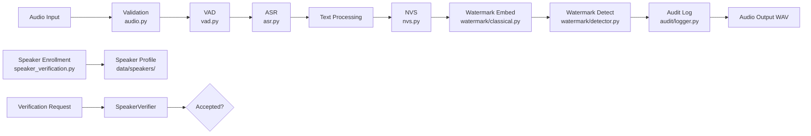

# EchoSelf — System Architecture

## End-to-End Pipeline



## Module Map

```
ai/src/echoself_ai/
│
├── voice/
│   ├── audio.py            — WAV I/O, resampling, normalization, synthetic tone
│   ├── features.py         — LogMelSpectrogram (80-band, STFT-based)
│   ├── vad.py              — EnergyVAD, VoiceActivityDetector, create_vad()
│   ├── vad_config.py       — VADConfig dataclass
│   ├── asr.py              — ASRModel (CNN+GRU+CTC), CTCDecoder, SpeechRecognizer
│   ├── asr_config.py       — ASRConfig dataclass
│   ├── nvs.py              — TextToSpeech (AcousticModel → Griffin-Lim)
│   ├── acoustic_model.py   — AcousticModel, ConvBlock, AcousticModelConfig
│   ├── vocoder.py          — GriffinLimVocoder
│   ├── speaker_verification.py — SpeakerEncoder, SpeakerEnrollment, SpeakerVerifier
│   ├── consent.py          — VoiceConsentManager
│   └── dataset.py          — SpeechDataset
│
├── watermark/
│   ├── classical.py        — SpreadSpectrumWatermarker, n_bit_watermark_id_to_bits
│   ├── learned.py          — WatermarkEncoder, WatermarkDecoder, LearnedWatermarker
│   ├── detector.py         — WatermarkDetector, DetectionResult
│   └── config.py           — ClassicalWatermarkConfig
│
├── audit/
│   └── logger.py           — AuditLogger, AuditRecord, compute_audio_hash
│
├── pipeline/
│   └── orchestrator.py     — SpeechPipeline, PipelineConfig, PipelineResult
│
├── security/
│   ├── sanitizer.py        — PromptSanitizer (injection defense)
│   ├── integrity.py        — checkpoint SHA-256 verification
│   └── watchdog.py         — resource watchdog (CPU/RAM/VRAM guards)
│
├── service/
│   ├── server.py           — Flask HTTP server
│   ├── pipeline.py         — service handlers including speech_pipeline_endpoint
│   └── unified.py          — unified multimodal service
│
├── transformer/            — Decoder-only transformer (language model)
├── training/               — Trainer, cosine LR scheduler, checkpointing
├── vision/                 — Image encoder, avatar generator
└── video/                  — Video frame processing
```

## Data Flow — Speech Synthesis with Watermarking

```
Input WAV (16-bit PCM, 16 kHz)
  │
  ▼
audio.py::ingest_audio()
  - Validates header, bit depth, duration, NaN
  - Returns (waveform: Tensor[N], sample_rate: 16000)
  │
  ▼
vad.py::EnergyVAD.detect()
  - Frame-level energy thresholding
  - Returns [(start_sec, end_sec), ...]
  │
  ▼  (first speech segment)
asr.py::SpeechRecognizer.recognize()
  - Log-mel spectrogram extraction (80 mels, n_fft=512, hop=128)
  - CNN+GRU encoder → CTC logits → greedy decode
  - Returns transcript: str
  │
  ▼
nvs.py::TextToSpeech.synthesize()
  - CharacterTokenizer → token_ids
  - AcousticModel(token_ids, speaker_id) → mel [n_mels × T]
  - GriffinLimVocoder(mel) → waveform [N]
  - Normalize to peak 0.95
  │
  ▼
watermark/classical.py::SpreadSpectrumWatermarker.embed()
  - Generates PN sequence from SHA-256(watermark_id)
  - waveform += alpha * pn  (alpha=0.01, SNR≈35 dB)
  │
  ▼
watermark/detector.py::WatermarkDetector.detect_classical()
  - Recomputes PN sequence, normalized cross-correlation
  - Returns DetectionResult(detected, confidence, latency_ms)
  │
  ▼
audit/logger.py::AuditLogger.log()
  - Appends JSON line to data/audit/audit_log.jsonl
  - Stores: event_id, user_id, timestamp, watermark_id, output_hash
  │
  ▼
audio.py::write_wav()
  - Output WAV file (16-bit PCM, 16 kHz)
```

## Go Backend Integration

```
HTTP Client (curl / Bruno / frontend)
  │  POST /api/v1/jobs
  ▼
Go Gin API Server (cmd/api/main.go)
  │  Enqueues job via Redis
  ▼
Go Worker (cmd/worker/main.go)
  │  Calls Python service via HTTP
  ▼
Python Flask Service (service/server.py)
  │  Routes to speech_pipeline_endpoint()
  ▼
SpeechPipeline.process()
  │  Returns JSON with base64 WAV audio
  ▼
Go Worker stores result in PostgreSQL
```

## Security Architecture

- **Consent gates**: `VoiceConsentManager.enforce_gate()` checked before every synthesis and verification
- **Checkpoint integrity**: SHA-256 hashes stored alongside every model checkpoint
- **Prompt sanitization**: `PromptSanitizer` strips injection attempts from text inputs
- **Resource watchdog**: monitors CPU, RAM, and VRAM; raises `ResourceExhaustedError` if limits exceeded
- **Audit log**: append-only JSONL; `verify_integrity()` detects tampered records
- **Speaker profiles**: stored as base64-encoded numpy bytes in JSON; never exposed through public endpoints
- **Rate limiting**: Go middleware enforces per-IP rate limits on all API endpoints
